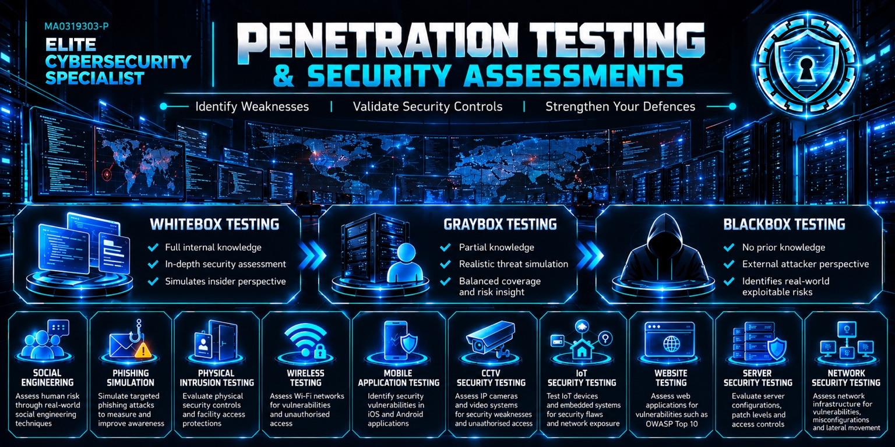
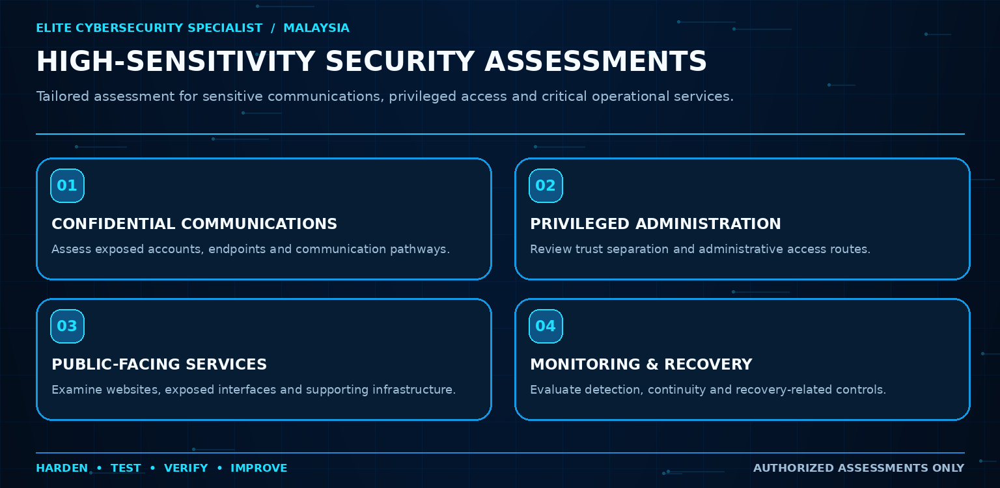
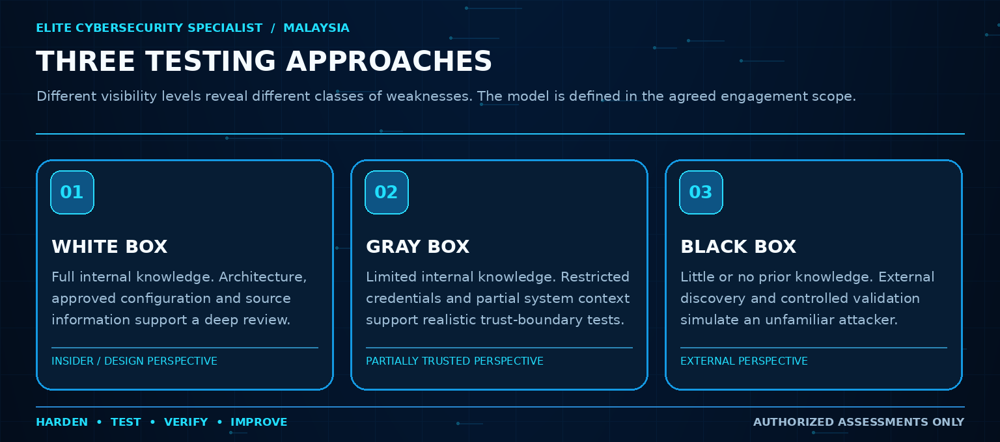
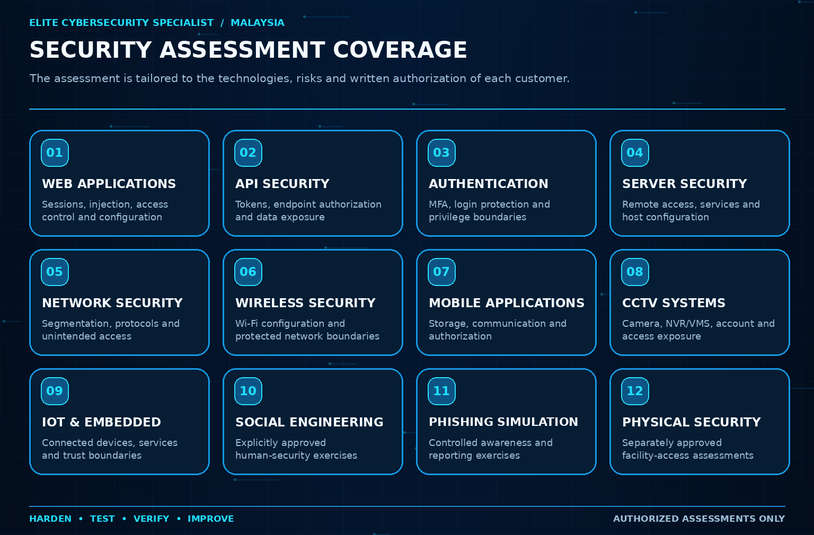
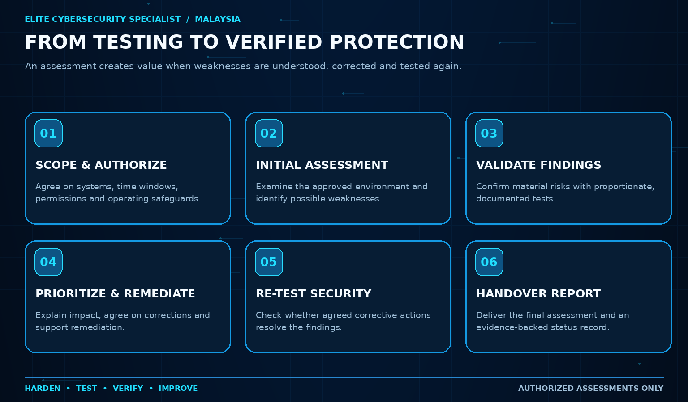
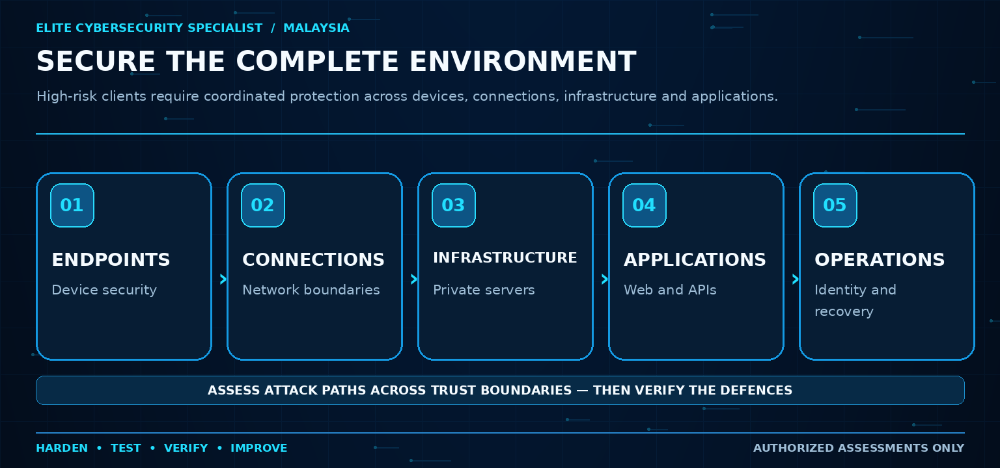
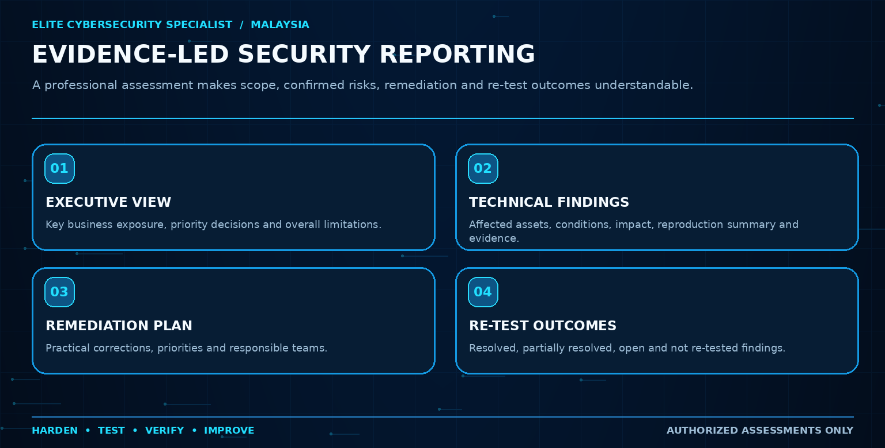
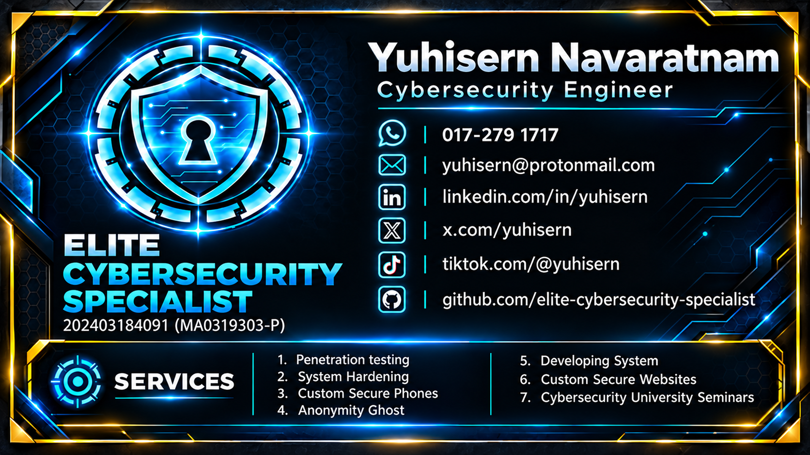

<p align="center">
  
</p>

<h1 align="center">PENETRATION TESTING & SECURITY ASSESSMENTS</h1>

<p align="center"><strong>ELITE CYBERSECURITY SPECIALIST · MALAYSIA</strong></p>

<p align="center"><strong>Identify Weaknesses | Validate Security Controls | Strengthen Your Defences</strong></p>

<p align="center">Business Registration: <strong>202403184091 (MA0319303-P)</strong></p>

<p align="center">
  <a href="https://github.com/elite-cybersecurity-specialist/company-profile/raw/refs/heads/main/pdf/ECS_Company_Profile.pdf">Download Company Profile (PDF)</a>
  &nbsp;·&nbsp;
  <a href="https://github.com/elite-cybersecurity-specialist/company-profile">View Company Profile Repository</a>
  &nbsp;·&nbsp;
  <a href="https://github.com/elite-cybersecurity-specialist">View Other Cybersecurity Subjects</a>
  &nbsp;·&nbsp;
  <a href="https://www.linkedin.com/company/elite-cybersecurity-specialist/">LinkedIn Company Page</a>
  &nbsp;·&nbsp;
  <a href="https://elite-cybersecurity-specialist.blogspot.com">Official ECS Blog</a>
  &nbsp;·&nbsp;
  <a href="mailto:Yuhisern@protonmail.com">Contact ECS</a>
</p>

> **HARDEN. TEST. VERIFY. IMPROVE.**  
> Security must be engineered into the environment, tested from an attacker’s perspective, validated, remediated, re-tested and maintained.

---

## Contents

- [About Our Penetration-Testing Services](#about-our-penetration-testing-services)
- [Who Our Services Are Designed For](#who-our-services-are-designed-for)
- [Whitebox, Graybox and Blackbox Testing](#whitebox-graybox-and-blackbox-testing)
- [Our Penetration-Testing Areas](#our-penetration-testing-areas)
- [Our Testing, Remediation and Verification Method](#our-testing-remediation-and-verification-method)
- [Complete-Environment Security](#complete-environment-security)
- [Reports and Customer Deliverables](#reports-and-customer-deliverables)
- [Threat-Informed Assessment and Frameworks](#threat-informed-assessment-and-frameworks)
- [Authorized Testing and Customer Protection](#authorized-testing-and-customer-protection)
- [Independent Cybersecurity Research and Development](#independent-cybersecurity-research-and-development)
- [Supporting Technical Documentation](#supporting-technical-documentation)
- [Company Information and Contact](#company-information-and-contact)

---

## About Our Penetration-Testing Services

**ELITE CYBERSECURITY SPECIALIST (ECS)** is a Malaysia-based cybersecurity company founded in 2024. Our company profile describes more than 10 years of cybersecurity experience and a security-engineering practice focused on protecting high-sensitivity systems and the people who depend on them.

We assess security from an attacker's perspective using **authorized and controlled testing**. Our purpose is to identify weaknesses, validate practical risk, recommend remediation and perform a **final penetration test to verify** whether important weaknesses have been corrected.

Our work considers the security relationship between **devices, user identities, communication paths, network boundaries, servers, web applications, APIs, administrative access and monitoring**. Each customer engagement is individually scoped. We do not assume that every system or every testing technique is appropriate for every customer.

**Our principle:** A scanner finding is a starting point for investigation—not a substitute for a confirmed, contextualized security assessment.

---

## Who Our Services Are Designed For

<p align="center"></p>

Our company profile identifies the following customer groups as potential beneficiaries of security assessment and protection:

| Customer profile | Assessment priorities |
|---|---|
| **Executives, VIPs and High-Profile Individuals** | Sensitive devices, privileged accounts, private communications, exposed services and personal operational security. |
| **Ministers, Public Officials and Sensitive Professional Teams** | Authorized systems, restricted administration, communication security and the boundaries between sensitive environments. |
| **Private Banks and Financial Organizations** | Financial portals, administrative systems, access control, exposed infrastructure and business-critical services. |
| **Family Offices and Private Wealth Organizations** | Confidential financial administration, communications, cloud accounts and private infrastructure. |
| **Investigative Journalists and Source-Protection Teams** | Access controls, communication exposure, endpoint risks and identity compartmentalization. |
| **Legal Professionals and Confidential Advisory Firms** | Sensitive client records, privileged access, document portals and secure communications. |
| **Private Casinos and Gaming Businesses** | Online services, internal systems, network exposure and payment-support environments. |
| **Businesses, Cybersecurity Teams and Research Organizations** | Web/API security, server/network assessment, validation, research and security control verification. |

> **High-sensitivity work requires discretion.** Client-specific environments, vulnerabilities, credentials, private configurations and internal security blueprints are not published in this repository.

---

## Whitebox, Graybox and Blackbox Testing

<p align="center"></p>

| Testing approach | Information provided | Why customers choose it |
|---|---|---|
| **WHITEBOX TESTING** | Extensive internal knowledge, including approved architecture, source information, configuration and credentials where relevant. | In-depth assessment of internal controls, implementation assumptions and privilege boundaries. |
| **GRAYBOX TESTING** | Partial knowledge or restricted, approved access. | Realistic partially trusted scenarios, authenticated testing and deeper trust-boundary analysis. |
| **BLACKBOX TESTING** | Little or no prior knowledge about internal details. | An external attacker's perspective on observable exposure and potentially exploitable weaknesses. |

An engagement may use one approach or a carefully defined combination. Testing depth, service disruption limits, authentication profiles and permitted techniques are agreed **before testing begins**.

[Read our engagement methodology →](docs/ENGAGEMENT_METHODOLOGY.md)

---

## Our Penetration-Testing Areas

<p align="center"></p>

| Assessment area | Customer-facing scope |
|---|---|
| **Web Application Testing** | Authentication, authorization, sessions, injection, input validation, configuration and OWASP-related risks. |
| **API Security Testing** | API endpoints, authorization, authentication, tokens, data exposure, rate controls and abuse paths. |
| **Authentication & Access Control** | MFA, account lockout, login security, session management and privilege boundaries. |
| **Server Security Testing** | Exposed services, operating-system weaknesses, remote administration, configuration and privileges. |
| **Network Penetration Testing** | Ports, segmentation, firewalls, insecure protocols and unintended paths of access. |
| **Wireless Security Testing** | Approved Wi-Fi environments, encryption, access controls and wireless exposure. |
| **Mobile Application Testing** | iOS/Android application storage, communication, authentication, APIs and security behavior. |
| **CCTV Security Testing** | Cameras, VMS/NVR systems, authentication, exposed interfaces, APIs and remote access. |
| **IoT Security Testing** | Embedded systems, connected devices, services, authentication and supporting platforms. |
| **Social Engineering Assessment** | Specifically authorized reviews of human security procedures and controls. |
| **Phishing Simulation** | Controlled awareness, reporting and organizational response exercises. |
| **Physical Security Testing** | Separately authorized testing of physical safeguards protecting systems or facilities. |

**Cross-cutting work:** vulnerability validation, risk prioritization, remediation guidance and **final re-testing** are used where included in the engagement scope.

[Explore our complete service catalog →](docs/SERVICE_CATALOG.md)

---

## Our Testing, Remediation and Verification Method

<p align="center"></p>

**Standard engagement flow in our company profile:**

```text
Infrastructure / Software Installation
        ↓
Penetration Test
        ↓
Identify Vulnerabilities
        ↓
Remediation
        ↓
Final Penetration Test to Verify
        ↓
Reporting
```

**Before the technical assessment:** We agree the scope, customer authorization, permitted systems, methods, exclusions, maintenance windows, emergency contacts and stop conditions. We then perform the approved work within these boundaries.

| Phase | Purpose |
|---|---|
| **1. Define scope and authorization** | Confirm ownership/permission, systems, operational risk, constraints and Rules of Engagement. |
| **2. Perform initial assessment** | Examine the approved environment using appropriate blackbox, graybox or whitebox methods. |
| **3. Validate and prioritize** | Confirm material findings, document security impact and distinguish confirmed risk from uncertainty. |
| **4. Recommend and support remediation** | Give practical corrective guidance to reduce underlying exposure or close exploitable paths. |
| **5. Conduct final re-testing** | Verify whether implemented corrections resolve the agreed findings without unacceptable side effects. |
| **6. Produce final reporting** | Record findings, their status, risk context, agreed exclusions and next steps. |

The exact sequence may adapt to urgent findings, business-critical systems and customer change-control requirements.

[Methodology →](docs/ENGAGEMENT_METHODOLOGY.md) · [Scoping and Rules of Engagement →](docs/SCOPING_AND_RULES_OF_ENGAGEMENT.md)

---

## Complete-Environment Security

<p align="center"></p>

A strong control on one device does not automatically protect connected accounts, server administration, payment workflows or communications. ECS therefore considers both **component weaknesses** and **the trust relationships between components**.

Where relevant, an assessment may examine the route from a public-facing service to private infrastructure, the protection of privileged accounts, segmentation between devices, or whether hardening controls actually enforce the intended restrictions.

**Related engineering reference:** Our public [Kicksecure High-Assurance Hardening Project](https://github.com/elite-cybersecurity-specialist/hardening-challenge) documents defensive security engineering and validation. This is a separate hardening reference, **not** a claim that its results are penetration-testing results for customers.

---

## Reports and Customer Deliverables

<p align="center"></p>

Customer deliverables are defined in the engagement agreement and may include:

- **Executive summary:** exposure themes, highest-priority decisions and overall assessment limitations.
- **Technical findings:** affected scope, severity rationale, conditions, evidence, impact and corrective recommendations.
- **Remediation plan:** proposed corrections and a practical order of implementation.
- **Re-test results:** which vulnerabilities have been fixed, remain open, were partially addressed or could not be re-tested.
- **Final assessment report:** scope, methodology, exclusions, observations, risk status and conclusion.

Reports and evidence are delivered through an agreed secure channel. **Real customer weaknesses and raw confidential assessment results are not published here.**

[Reporting and deliverables →](docs/DELIVERABLES_AND_REPORTING.md)

---

## Threat-Informed Assessment and Frameworks

Our work may be informed by the following references as applicable to the assessed system:

| Framework or reference | How it informs the engagement |
|---|---|
| **OWASP Top 10 / OWASP WSTG / OWASP ASVS** | Web application risk categories, testing ideas and deeper verification requirements. |
| **OWASP API Security** | API authentication, authorization, data access and abuse scenarios. |
| **MITRE ATT&CK** | Relevant attacker behavior and realistic threat pathways. |
| **CIS Controls and Benchmarks** | Configuration weaknesses, exposure reduction and remediation baselines. |
| **DISA STIG / SRG principles** | Applicable high-security hardening objectives and control verification. |
| **NIST CSF 2.0 / NIST SP 800-53** | Risk-management, security-control and operational context. |
| **NIST SP 800-115** | Technical security-testing and assessment planning guidance. |
| **ISO/IEC 27001 and 27002 principles** | Organizational security-management context, where relevant. |

**Framework-informed work is not the same as a formal certification or audit.** The exact references and testing depth depend on the signed scope.

[Framework details →](docs/FRAMEWORKS_AND_REFERENCES.md)

---

## Authorized Testing and Customer Protection

Our assessment rules are designed to protect customers and their operations.

1. **Written authorization:** Only assets that the client owns or is explicitly entitled to authorize are tested.
2. **Defined boundaries:** Targets, credentials, techniques, timing and exclusions are documented before testing.
3. **Operational safeguards:** Destructive testing, sustained denial-of-service, data alteration, employee-targeted exercises and physical testing are excluded unless separately and specifically approved with suitable safeguards.
4. **Controlled evidence:** Capture only what is necessary, minimize sensitive-data exposure and secure all outputs.
5. **Escalation and stop procedures:** Establish technical and business contacts, critical-finding escalation and emergency stop conditions.
6. **Confidential reporting:** Publish generic methodology, not customer vulnerabilities, secrets or infrastructure blueprints.

[Scope and authorization →](docs/SCOPING_AND_RULES_OF_ENGAGEMENT.md) · [Confidentiality principles →](docs/CONFIDENTIALITY_AND_DISCLOSURE.md)

---

## Independent Cybersecurity Research and Development

ECS also develops specialized cybersecurity systems. The October 2026 company profile describes **Battle Offensive AI** as a **self-funded, in-development research project** focused on authorized autonomous penetration-testing workflows, especially blackbox assessments.

This project is **not represented here as a commercially available assessment system, externally certified capability, or automatically included service**. Project development and customer service engagements are distinct.

---

## Supporting Technical Documentation

| Document | Purpose |
|---|---|
| [Service Catalog](docs/SERVICE_CATALOG.md) | Full explanation of assessment services and coverage. |
| [Engagement Methodology](docs/ENGAGEMENT_METHODOLOGY.md) | Technical and operational assessment lifecycle. |
| [Scoping and Rules of Engagement](docs/SCOPING_AND_RULES_OF_ENGAGEMENT.md) | Legal authorization, permitted activities and operational protections. |
| [Deliverables and Reporting](docs/DELIVERABLES_AND_REPORTING.md) | What customers can expect in an assessment report. |
| [Frameworks and References](docs/FRAMEWORKS_AND_REFERENCES.md) | Standards and testing guidance referenced in the service. |
| [Confidentiality and Disclosure](docs/CONFIDENTIALITY_AND_DISCLOSURE.md) | Handling of client information and findings. |
| [Frequently Asked Questions](docs/FAQ.md) | Common customer questions. |
| [Image and Asset Guide](docs/ASSET_INDEX.md) | Image descriptions, credits and content usage. |
| [Publishing Instructions](PUBLISH_INSTRUCTIONS.md) | Local publication and GitHub commands. |

---

## Company Information and Contact

| Detail | Information |
|---|---|
| **Company** | ELITE CYBERSECURITY SPECIALIST |
| **Registered in** | Malaysia |
| **Business Registration** | 202403184091 (MA0319303-P) |
| **Founder / Contact** | Yuhisern Navaratnam |
| **Email** | [Yuhisern@protonmail.com](mailto:Yuhisern@protonmail.com) |
| **WhatsApp** | [+60 17-279 1717](https://wa.me/60172791717) |
| **Company Profile (PDF)** | [Download the full company profile](https://github.com/elite-cybersecurity-specialist/company-profile/raw/refs/heads/main/pdf/ECS_Company_Profile.pdf) |
| **Company Profile Repository** | [elite-cybersecurity-specialist/company-profile](https://github.com/elite-cybersecurity-specialist/company-profile) |
| **All Cybersecurity Subjects** | [GitHub — ELITE CYBERSECURITY SPECIALIST](https://github.com/elite-cybersecurity-specialist) |

**For assessment enquiries**, please describe the organization, general asset types, business objectives and preferred engagement model. Do not email passwords, private keys or live vulnerability details in the first enquiry.

---

## Connect with Elite Cybersecurity Specialist

**Yuhisern Navaratnam** — Cybersecurity Engineer  
**Elite Cybersecurity Specialist** | Malaysia  
**SSM:** 202403184091 (MA0319303-P)

[](assets/00-ecs-digital-name-card.png)

**GitHub — Company Profile:** [Official repository](https://github.com/elite-cybersecurity-specialist/company-profile)  
**GitHub — Penetration Testing:** [Official repository](https://github.com/elite-cybersecurity-specialist/penetration-testing)  
**GitHub — Battle-Hardened AI:** [Official repository](https://github.com/elite-cybersecurity-specialist/battle-hardened-ai)  
**GitHub — Other Cybersecurity Projects:** [Elite Cybersecurity Specialist](https://github.com/elite-cybersecurity-specialist)  
**TikTok:** [@yuhisern](https://www.tiktok.com/@yuhisern)  
**LinkedIn:** [linkedin.com/in/yuhisern](https://www.linkedin.com/in/yuhisern)  
**X:** [x.com/yuhisern](https://x.com/yuhisern)  
**LinkedIn — ECS Company:** [Elite Cybersecurity Specialist](https://www.linkedin.com/company/elite-cybersecurity-specialist/)  
**Official ECS Blog:** [ECS Cybersecurity Articles](https://elite-cybersecurity-specialist.blogspot.com)

---

<p align="center"><strong>HARDEN. TEST. VERIFY. IMPROVE.</strong></p>
<p align="center"><em>Identify Weaknesses · Validate Security Controls · Strengthen Your Defences</em></p>
<p align="center"><sub>ELITE CYBERSECURITY SPECIALIST | Penetration Testing & Security Assessments | October 2026. All services subject to separate written authorization, feasibility, agreed scope and contractual terms. See <a href="NOTICE.md">usage notice</a>.</sub></p>
